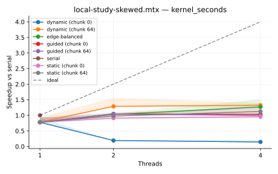
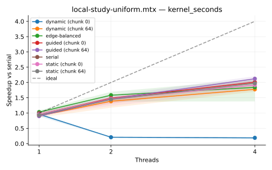
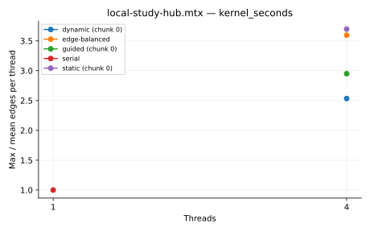

# Measured local validation and exploratory performance analysis

These are local Apple M4 results, not ARC results or final cluster conclusions. The implementation was built with Apple LLVM 17 at `-O3`, C++17, without fast-math, using Homebrew libomp 23.1.5. See [hardware details](local-hardware.txt) and archived source/metadata for exact flags. The OpenMP compile-time macro is 202011.

## Evidence and reproducibility

The final local timing matrix contains **924 verified measured solves**: six graphs × 22 strategy/thread/chunk configurations × seven randomized blocks, each using 100 fixed iterations, damping 0.85, tolerance 0 and one unreported warmup. Parallel thread counts are 1, 2 and 4. Static/dynamic/guided use chunk values 0 and 64; serial and edge-balanced use 0. Chunk 0 means static blocks or dynamic/guided minimum chunk 1. A serial verification solve precedes warmups in each command. A separate instrumented experiment contains **90 solves**: six graphs × five configurations (serial p=1 and each parallel policy p=4) × three blocks, also at 100 iterations. Earlier smoke runs remain in `results/local-study`, `results/local-profile` and `results/local-wiki`; the tables here use only `local-optimized` and `local-optimized-profile`. The earlier five-barrier matrix is preserved in `local-validation-initial.md` and `evidence/local-evaluation.tar.gz`. The current solver combines scalar resets with the buffer swap and computes the base privately, using three synchronization barriers per iteration.

Source snapshots, per-file source hashes, binary/dataset hashes, commands, raw JSON, summaries and environment are preserved in [the evidence archive](evidence/local-optimized.tar.gz). Selected CSVs and figures are also directly readable in `report/evidence/`. The binary hash is recorded, while machine-specific binaries and graph files are not committed. Rebuild from the source snapshot and reproduce synthetic data with the commands below. Public dataset retrieval metadata is included. Original absolute paths identify the run's machine; adapt paths when reproducing.

```sh
python3 scripts/generate_graph.py --kind uniform --vertices 20000 --edges 200000 --seed 548 --output data/local-study-uniform.mtx
python3 scripts/generate_graph.py --kind skewed --vertices 20000 --edges 200000 --seed 548 --output data/local-study-skewed.mtx
python3 scripts/generate_graph.py --kind hub --vertices 20000 --edges 200000 --seed 548 --output data/local-study-hub.mtx
python3 scripts/generate_graph.py --kind local --vertices 20000 --edges 200000 --seed 548 --output data/local-study-local.mtx
python3 scripts/generate_graph.py --kind local --vertices 20000 --edges 200000 --seed 548 --permute --output data/local-study-permuted.mtx
python3 scripts/fetch_dataset.py wiki-Vote
```

The hardware has four performance and six efficiency cores, 16 GiB RAM, and macOS 15.7.3. Workers were not pinned to a known performance-core subset. Only `OMP_DYNAMIC=FALSE` was set explicitly for these runs. The sandbox blocked the benchmark's sysctl query; its error is preserved, and a separate permitted hardware query supplies the hardware note. These are warm repeated-solve measurements on a shared interactive computer. They do not establish homogeneous-core, multisocket, NUMA or DRAM-bandwidth behavior.

## Correctness

Release and AddressSanitizer/UndefinedBehaviorSanitizer runs passed 14,143 C++ assertions and 43 CLI/input cases. Four Python experiment tests also pass, including a subprocess benchmark-to-summary integration test. Small-graph tests compare against analytic values and an independent dense transition-matrix oracle. No failure or nonfinite rank was observed in the timing matrix. All ranks passed L1 ≤ 1e-8 and Linf ≤ 1e-9 against the serial reference; observed maximum errors are listed below. Floating-point equality is not assumed.

Maximum observed timing-matrix verification errors: **L1 1.641e-14**, **Linf 5.551e-17**.

## Graph structure

| Graph | n | m | Max indegree | Indegree CV | Dangling | Isolated |
| --- | --- | --- | --- | --- | --- | --- |
| hub | 20000 | 200000 | 179760 | 127.106 | 0 | 0 |
| local | 20000 | 200000 | 23 | 0.318 | 1 | 0 |
| permuted | 20000 | 200000 | 23 | 0.318 | 1 | 0 |
| skewed | 20000 | 200000 | 28881 | 25.021 | 1 | 0 |
| uniform | 20000 | 200000 | 25 | 0.317 | 1 | 0 |
| wiki-Vote | 8298 | 103689 | 457 | 2.386 | 2188 | 1183 |

Raw numeric IDs are retained. For wiki-Vote, 1,183 gaps become isolated vertices, producing n=8,298 and m=103,689. This is a documented vertex-universe choice and is not the compact active-vertex graph in the source statistics. Synthetic local and permuted graphs are the same topology under a seeded relabeling and have identical degree statistics.

## Runtime and four-thread speedup

Serial times are median kernel milliseconds. Speedups are medians of the seven block-paired serial/variant ratios; a ratio of median runtimes may differ slightly. Every policy/thread/chunk result, variability metric and bootstrap interval is retained in [the full summary](evidence/optimized-summary.csv).

| Graph | Serial ms | Static blocks | Dynamic 1 | Dynamic 64 | Guided 1 | Edge balanced |
| --- | --- | --- | --- | --- | --- | --- |
| hub | 28.551 | 1.018 | 0.220 | 1.079 | 1.054 | 1.077 |
| local | 24.326 | 2.106 | 0.212 | 1.851 | 2.093 | 2.163 |
| permuted | 24.298 | 1.698 | 0.191 | 1.908 | 1.485 | 1.984 |
| skewed | 23.749 | 0.955 | 0.145 | 1.325 | 1.032 | 1.269 |
| uniform | 25.541 | 1.915 | 0.189 | 1.776 | 2.010 | 1.840 |
| wiki-Vote | 9.402 | 1.122 | 0.189 | 1.099 | 1.145 | 1.232 |

On the skewed graph, static blocks take 25.097 ms at p=4 versus 18.673 ms for edge balance, a 25.6% median runtime reduction. Paired serial speedups are 0.955× and 1.269× respectively. Dynamic chunk 64 reaches 1.325×. Dynamic chunk 1 is slower than serial across these small graph families; dispatch and scattered output ownership are plausible explanations supported by the chunk comparison, though runtime attribution with Linux perf is still needed.

On the hub graph, useful parallel strategies stay near serial performance. On the vote graph, edge balancing reaches 1.232× at four threads. The variation across graph families demonstrates why balanced assigned edges alone are insufficient evidence of scalable performance.

## Assigned-edge imbalance

Separate profiling runs measure max/mean cumulative incoming edges per worker. Ratios near one indicate balanced edge ownership; this says nothing by itself about cache misses, contribution-pass cost or barrier overhead.

| Graph | Static blocks, p=4 | Edge balanced, p=4 |
| --- | --- | --- |
| hub | 3.69686 | 3.59520 |
| local | 1.00794 | 1.00006 |
| permuted | 1.00424 | 1.00016 |
| skewed | 3.67300 | 1.02690 |
| uniform | 1.00508 | 1.00024 |
| wiki-Vote | 1.28241 | 1.00153 |

Skewed edge imbalance falls from 3.673 to 1.0269. In contrast, the hub has 179,760 of 200,000 edges in a single incoming row. Since rows are indivisible, the max/mean edge-work lower bound at p=4 is `179760 / 50000 = 3.5952`, exactly attained by the edge-balanced partition. This provides a structural explanation for its failure to distribute that row across workers. The pure edge-traversal model's speedup ceiling is only `m / max_indegree ≈ 1.113`, before considering other phases and scheduling costs.

The vote graph's edge ratio also becomes nearly one, yet its speedup remains far below four. Fixed synchronization/row work, memory access, and interactive-machine noise are candidate causes; the current data cannot uniquely identify them.

## Setup cost

For edge-balanced p=4, partition construction is timed independently and included in setup. The table gives median partition/setup microseconds and median total solve milliseconds. Team entry/exit and buffer initialization also contribute to setup. A fair preprocessing comparison must use total time, especially when reducing the number of iterations.

| Graph | Partition µs | Setup µs | Total ms |
| --- | --- | --- | --- |
| hub | 0.75 | 113.00 | 26.303 |
| local | 0.83 | 83.12 | 11.418 |
| permuted | 0.92 | 44.25 | 12.024 |
| skewed | 0.83 | 56.79 | 18.762 |
| uniform | 0.88 | 76.29 | 13.290 |
| wiki-Vote | 0.79 | 46.92 | 7.758 |

See [total-time summaries](evidence/optimized-total-summary.csv). These measurements amortize setup over 100 iterations; a final study should also sweep shorter solves to find the crossover where setup matters.

## Locality and uncertainty

The local/permuted comparison does not justify a cache-miss or bandwidth claim. Their serial medians are similar, while some parallel cases differ and show substantial run variation. Relabeling changes contribution addresses and row ordering together. Counter evidence, larger graphs crossing known cache sizes, and controlled worker/memory placement are necessary to explain causality.

No outliers were removed. The following are the five largest coefficients of variation in the timing matrix; max/median exposes slow runs. Inspect raw samples and use the repeated ARC runs before relying on these cases. Bootstrap median intervals do not eliminate systematic laptop interference.

| Graph | Policy | p | Chunk | CV | Max/median |
| --- | --- | --- | --- | --- | --- |
| uniform | static | 2 | 0 | 0.468 | 2.62 |
| permuted | dynamic | 1 | 64 | 0.438 | 2.36 |
| permuted | guided | 2 | 0 | 0.418 | 2.34 |
| uniform | dynamic | 2 | 64 | 0.409 | 2.34 |
| skewed | guided | 2 | 64 | 0.409 | 2.28 |

## Remaining ARC work

Run the supplied Slurm template after selecting the appropriate account/partition and compiler environment. Evaluate additional graph sizes, at least a second real graph, all allocated physical cores, broader chunk sweeps and close/spread affinity. Capture topology, NUMA placement and hardware counters where allowed, plus kernel-versus-total timing. Complete the final report and presentation using those measurements. No cluster job was submitted and no ARC timing, hardware-counter or NUMA result is asserted here.

## Selected figures






